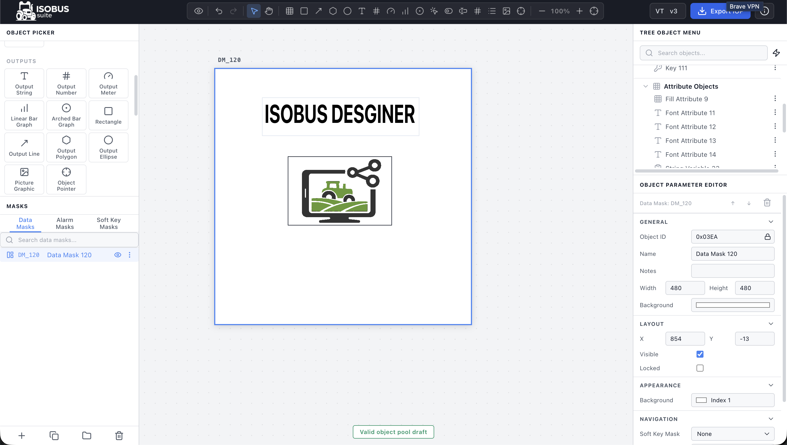

# ISOBUS IOP Editor

Browser-based editor for ISO 11783-6 Virtual Terminal Object Pools (.iop). Built with React + TypeScript + Vite.

> **Beta software:** this project is under active development and is not ready for production use. Validate any exported `.iop` files thoroughly before using them with real equipment or operational Virtual Terminals.

## What

ISOBUS (ISO 11783) is the standard protocol for communication between tractors, implements, and their electronic control units. Part 6 defines the Virtual Terminal — a display that dynamically renders a machine's user interface from a binary Object Pool (.iop) file.

This editor lets you design those VT screens in a browser: place objects on a canvas, configure their properties, reference variables and attributes, and export `.iop` files for testing and validation.



## Quick start

```bash
npm install
npm run dev        # dev server (Vite)
npm run build      # typecheck + production build
npm test           # run tests
```

## Features

- Visual canvas editor with pan, zoom, snap-to-grid, drag-select, multi-select, move, and resize
- Object creation from toolbar or palette sidebar
- Per-object property panels with VT palette colour pickers
- Binary `.iop` export with pre-export validation and round-trip smoke test
- Undo/redo stack
- Picture Graphic upload with quantisation to 1/4/8-bit palette-indexed formats
- Number/string variable references and font/line/fill attribute references
- Working Set designator configuration
- Keyboard shortcuts: `Ctrl+Z` / `Ctrl+Shift+Z` undo/redo, `Delete` remove, `Escape` deselect

## Object implementation

### VT3 — fully implemented (27 types)

| | Object | Type |
|---|--------|------|
| ✅ | Working Set | 0 |
| ✅ | Data Mask | 1 |
| ✅ | Alarm Mask | 2 |
| ✅ | Container | 3 |
| ✅ | Soft Key Mask | 4 |
| ✅ | Key | 5 |
| ✅ | Button | 6 |
| ✅ | Input Boolean | 7 |
| ✅ | Input String | 8 |
| ✅ | Input Number | 9 |
| ✅ | Input List | 10 |
| ✅ | Output String | 11 |
| ✅ | Output Number | 12 |
| ✅ | Output Line | 13 |
| ✅ | Output Rectangle | 14 |
| ✅ | Output Ellipse | 15 |
| ✅ | Output Polygon | 16 |
| ✅ | Output Meter | 17 |
| ✅ | Output Linear Bar Graph | 18 |
| ✅ | Output Arched Bar Graph | 19 |
| ✅ | Picture Graphic | 20 |
| ✅ | Number Variable | 21 |
| ✅ | String Variable | 22 |
| ✅ | Font Attribute | 23 |
| ✅ | Line Attribute | 24 |
| ✅ | Fill Attribute | 25 |
| ✅ | Object Pointer | 27 |

### VT4 / VT5 — not yet implemented

| | Object | Version |
|---|--------|---------|
| ❌ | Window Mask | VT4 |
| ❌ | Key Group | VT4 |
| ❌ | Graphics Context | VT4 |
| ❌ | Colour Map | VT4 |
| ❌ | Input Attribute | VT4 |
| ❌ | Extended Input Attribute | VT4 |
| ❌ | External Object Definition | VT4 |
| ❌ | External Reference NAME | VT4 |
| ❌ | External Object Pointer | VT4 |
| ❌ | Animation | VT5 |

## Future

- VT4 / VT5 object types (see table above)
- Macro editor
- `.iop` file import / round-trip editing
- Multi-language string support
- Object tree panel with drag-to-reparent
- Pre made objects, like Gauge with labels and full projects template
- VT simulation (preview running screens with live variable interaction)
- Richer canvas guides (alignment lines, distribution)
- More keyboard shortcuts 
- etc...
